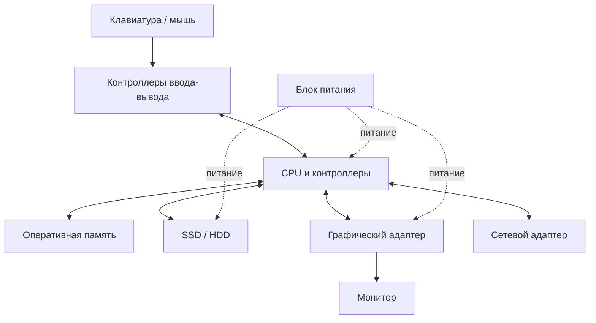

# Итог 1 — Устройство персонального компьютера

**Дисциплина:** Взаимодействие человека с компьютером  
**Цель:** изучить основные компоненты системного блока, связи между ними и роль программного обеспечения.   
**Характер работы:** аналитический отчёт на примере типичного настольного ПК, без утверждения о физическом исследовании конкретного устройства.

## 1. Аппаратные компоненты

| Компонент | Назначение | Взаимодействие |
|---|---|---|
| Материнская плата | Соединяет остальные компоненты | Сокет процессора, разъёмы RAM, PCIe, SATA, M.2, USB |
| CPU (процессор) | Выполняет инструкции, вычисляет и управляет выполнением программ | Читает инструкции и данные из памяти, взаимодействует с контроллерами |
| RAM | Временное хранение работающих программ и данных | Быстрый доступ CPU; при отключении питания обычная оперативная память теряет содержимое |
| SSD/HDD | Долговременное хранение файлов и ОС | Передаёт блоки данных через контроллер накопителя |
| GPU | Обработка графики и вывод изображения | Интегрирован в процессор или подключён по PCIe, формирует кадры для монитора |
| Блок питания | Преобразует сетевое питание в нужные напряжения | Питает плату, накопители, внешнюю видеокарту |
| Система охлаждения | Отводит тепло | Радиаторы и вентиляторы предотвращают перегрев CPU/GPU |
| Сетевая карта | Обмен данными по сети | Получает и передаёт пакеты через Ethernet или Wi-Fi |
| Клавиатура, мышь, монитор | Ввод команд и вывод результата | USB/Bluetooth для ввода; HDMI/DisplayPort для изображения |

## 2. Логическая схема

Схема логическая: конкретная топология подключения зависит от поколения процессора, чипсета и платы.

## 3. Цикл выполнения действия

Пример: пользователь открывает текстовый редактор, вводит символ и сохраняет документ.

1. После нажатия кнопки питания запускается прошивка UEFI, которая инициализирует оборудование и передаёт управление загрузчику ОС.
2. Операционная система загружает программу с SSD в память и выделяет ресурсы процессу.
3. Нажатие клавиши создаёт событие ввода. Контроллер и драйвер передают его операционной системе.
4. ОС доставляет событие активному приложению. CPU выполняет инструкции редактора, данные редактируемого документа обновляются в RAM.
5. Графическая подсистема строит новое изображение. Монитор показывает символ; пользователь получает визуальное подтверждение действия.
6. Команда сохранения вызывает файловую операцию: ОС записывает данные на накопитель. Индикатор сохранения подтверждает результат.

В этом процессе важны и физическая совместимость оборудования, и правильная работа драйверов, и понятность реакции интерфейса.

## 4. Виды программного обеспечения

| Категория | Функции | Примеры |
|---|---|---|
| Системное ПО | Управление ресурсами, файлами, процессами и устройствами | Linux, Windows, драйверы |
| Прикладное ПО | Выполнение задач пользователя | Текстовый редактор, браузер, графический редактор |
| Инструментальное ПО | Создание, сборка, проверка и диагностика программ | Python, компиляторы, IDE, Git |
| Прошивка | Низкоуровневое управление устройствами и начальная загрузка | UEFI, прошивка SSD |
| Служебные программы | Обслуживание и диагностика системы | Резервное копирование, просмотр журналов, антивирус |

Границы между категориями условны: некоторые инструменты являются одновременно прикладными программами для разработчика.

## 5. Связь с HCI

Интерфейс превращает внутренние состояния компьютера в понятные сигналы для пользователя. Для редактора важны читаемый шрифт, быстрый отклик, подтверждение сохранения и возможность отменить ошибочное действие. Производительность аппаратуры влияет на задержку; программа должна при долгой операции показывать прогресс, а не создавать впечатление зависания.

## Вывод

Компьютер работает как система взаимосвязанных аппаратных и программных уровней. Процессор обрабатывает данные, память обеспечивает доступ к рабочему состоянию, накопитель сохраняет файлы, а устройства ввода и вывода связывают машинное выполнение с действиями человека. Удобство определяется не только компонентами, но и тем, как ПО представляет их работу пользователю.
