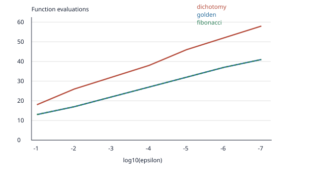

# Коллоквиум 1 — одномерная оптимизация

## Цель

Найти минимум унимодальной функции, сравнить методы дихотомии, золотого сечения и Фибоначчи по числу вычислений функции, построить начальный интервал минимума.

## Постановка

Для практического исследования используется семейство f(x) = (x − i)² на отрезке [-2, 20], i = 1…12. В каталоге results приведён **демонстрационный вариант i = 1**; индивидуальный вариант выбирается при запуске.

Дихотомия выбирает точки около середины, золотое сечение переносит одну ранее вычисленную точку на следующую итерацию, метод Фибоначчи задаёт отношения длин с помощью последовательности Фибоначчи. Интервал минимума находится удвоением шага в направлении убывания.

## Результаты

- [Таблица вычислений для точностей 10⁻¹ … 10⁻⁷](results/counts.csv).
- [Дихотомия, ε = 10⁻⁷](results/dichotomy.csv).
- [Золотое сечение, ε = 10⁻⁷](results/golden.csv).
- [Фибоначчи, ε = 10⁻⁷](results/fibonacci.csv).
- [Поиск начального интервала](results/bracket.csv).



При точности 10⁻⁷ получено 58 вычислений для дихотомии, 41 для золотого сечения и 41 для Фибоначчи (используется запас на заключительный шаг). Все методы находят x ≈ 1; начальный интервал [0.3, 1.5] содержит минимум. Золотое сечение и Фибоначчи экономят вычисления благодаря повторному использованию значений функции.

## Запуск

```bash
python main.py 1
python plot.py
```

Аргумент — номер демонстрационной функции; для исследования другого варианта укажите соответствующий номер.
