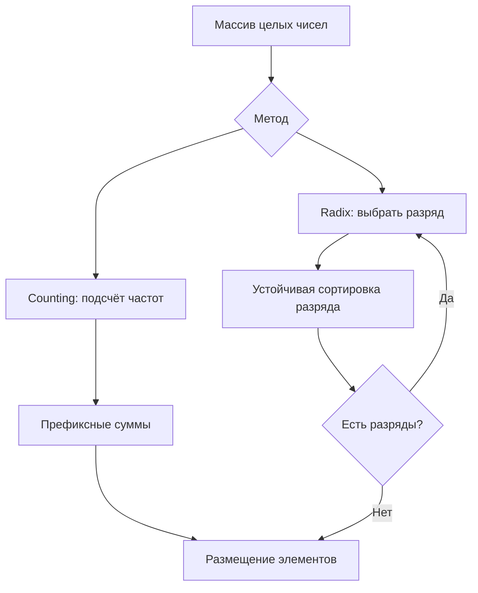
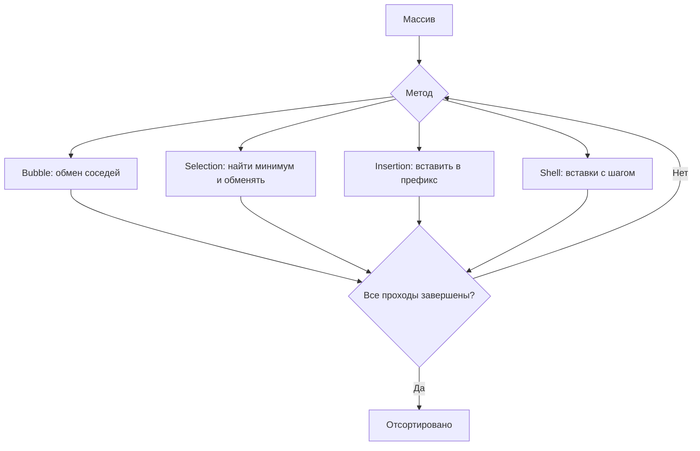
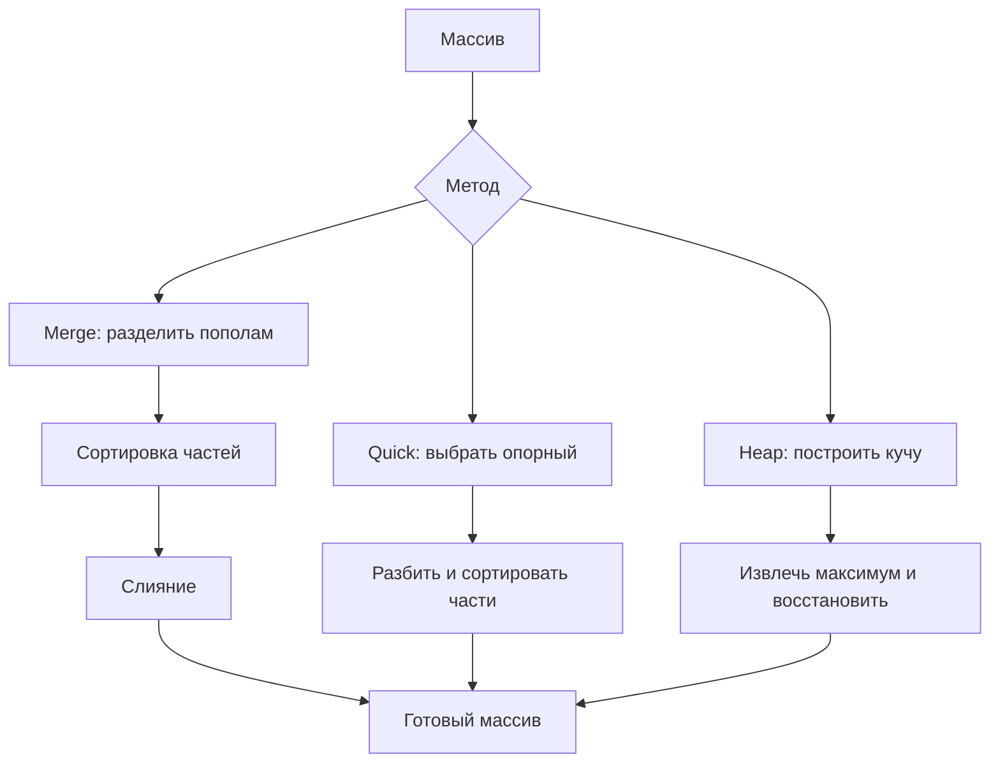

# Коллоквиум 2 — массивы и сортировки

## Массивы

[arrays.py](arrays.py) — четыре самостоятельных упражнения: сумма положительных, разворот массива, максимум строк матрицы, транспонирование. Для точного выполнения четырёх индивидуальных задач необходимо получить указанную преподавателем методичку по обработке массивов.

## Алгоритмы сортировки

Реализации на C находятся в [sorting.c](sorting.c). Поддерживаются все комбинации 25 вариантов второго и 16 вариантов третьего коллоквиума, плюс бинарные вставки и MSD.

| Алгоритм | Время, худший случай | Доп. память | Устойчивый | На месте |
|---|---|---|---|---|
| Counting | O(n+k) | O(n+k) | да | нет |
| Radix LSD | O(d(n+b)) | O(n+b) | да | нет |
| Bubble | O(n²) | O(1) | да | да |
| Selection | O(n²) | O(1) | нет | да |
| Insertion | O(n²) | O(1) | да | да |
| Shell (деление шага пополам) | O(n²) | O(1) | нет | да |
| Merge | O(n log n) | O(n) | да | нет |
| Heap | O(n log n) | O(1) | нет | да |
| Quick | O(n²), среднее O(n log n) | O(log n) стек | нет | да |
| Binary insertion | O(n²) | O(1) | да | да |
| Radix MSD (двоичное разбиение) | O(dn) | O(d) стек | нет | да |

n — размер массива, k — диапазон ключей, d — число разрядов, b — основание разрядной сортировки.

## Эксперимент

Используется одинаковая последовательность псевдослучайных целых чисел 0–65535 для каждого алгоритма и размера. Замеряется время сортировки, ранее выделенный массив не включён. Считаются сравнения ключей, обмены и записи элементов в основной/вспомогательный массив; операции с массивами счётчиков не включены. Корректность результата каждого завершённого запуска проверяется сравнением с qsort.

Среда измерений: AMD EPYC 9V74, доступная память около 9.7 GiB, Debian GNU/Linux 13, GCC 14.2.0, параметры `-std=c11 -O2`. Время монотонных часов (один прогон, возможен разброс). Лимит одного измерения — 5 секунд.

Полная [таблица измерений](results.csv). В случае тайм-аута измерение не завершилось, поэтому время оставлено пустым, а не заменено числом.

| Алгоритм | 10 000 | 150 000 | 1 000 000 |
|---|---:|---:|---:|
| counting | 0.000136 с | 0.002890 с | 0.014846 с |
| radix | 0.000039 с | 0.000671 с | 0.006233 с |
| bubble | 0.196125 с | тайм-аут | тайм-аут |
| selection | 0.122072 с | тайм-аут | тайм-аут |
| insertion | 0.009892 с | 2.178268 с | тайм-аут |
| shell | 0.000826 с | 0.017563 с | 0.147534 с |
| merge | 0.000584 с | 0.012907 с | 0.090997 с |
| heap | 0.000976 с | 0.013976 с | 0.123984 с |
| quick | 0.000598 с | 0.011169 с | 0.067726 с |
| binary_insertion | 0.001660 с | 0.294103 с | тайм-аут |
| msd | 0.000630 с | 0.013412 с | 0.064488 с |

Counting и Radix эффективны для ограниченного диапазона ключей. Quick, Merge и Heap справились с миллионом элементов; квадратичные алгоритмы на крупных массивах не успели завершиться в заданный лимит. Shell значительно быстрее простых вставок на этих данных.

## Схемы алгоритмов







## Запуск

Все алгоритмы:

```bash
python benchmark.py --timeout 5
```

Назначенный вариант по номеру студента (замените 7 своим номером):

```bash
python benchmark.py --colloquium 2 --number 7 --output variant2.csv --timeout 60
python benchmark.py --colloquium 3 --number 7 --output variant3.csv --timeout 60
```

Для полного замера медленных методов увеличьте лимит. Сортировки в коллоквиуме 3 используют те же реализации, но другую таблицу вариантов.
