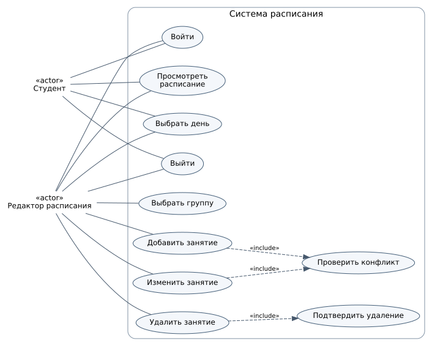

# UML — диаграмма вариантов использования

[PlantUML](uml/use-case.puml) · [DOT](uml/use-case.dot) · [SVG](uml/use-case.svg)

## Актёры

- Читатель: регистрируется, входит, ищет книги, просматривает собственную историю.
- Библиотекарь: входит, ведёт каталог, оформляет выдачу и возврат.
- Администратор: входит, управляет аккаунтами, анализирует просрочки и отчёты, создаёт и восстанавливает резервные копии.

Выдача включает проверку доступности книги и изменение остатка. Возврат включает изменение остатка; восстановление включает проверку копии. Доступ к операциям зависит от роли. Восстановление пароля возможно для аккаунта любого типа.
