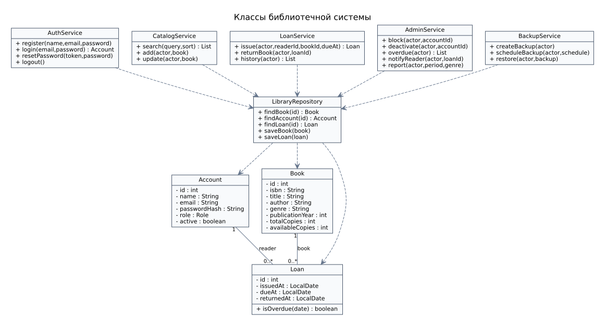
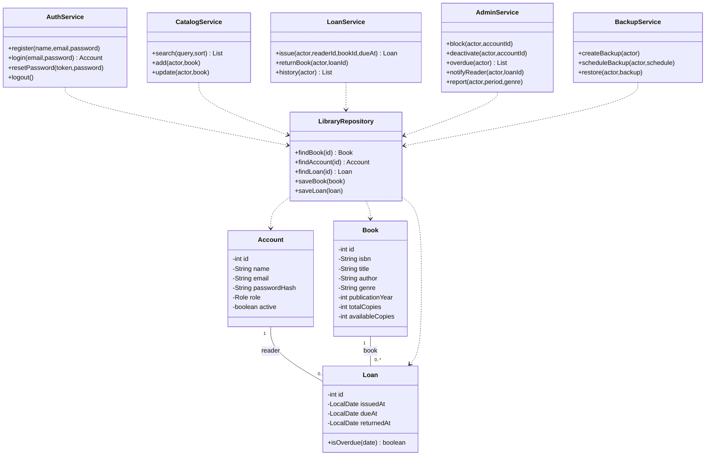

# UML — диаграмма классов

[Исходник DOT](uml/class-diagram.dot)

Account содержит роль и статус аккаунта; Book хранит данные фонда; Loan связывает читателя с конкретной книгой и датами выдачи и возврата. Сервисы проверяют права пользователя, применяют бизнес-правила и обращаются к хранилищу. Операции выдачи и возврата выполняются в транзакции.
