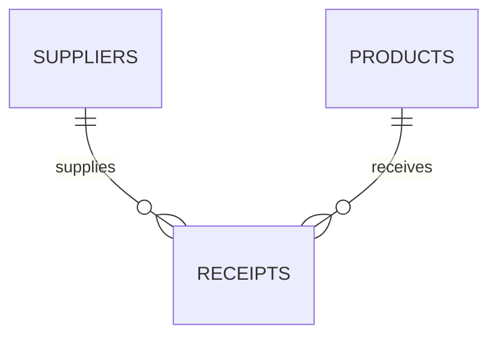

# Схема Commerce

Поставщики и товары связаны через таблицу прихода: каждая запись содержит дату, товар, поставщика и количество. Представление receipt_details соединяет три таблицы для отчётов и вычисляет стоимость.
