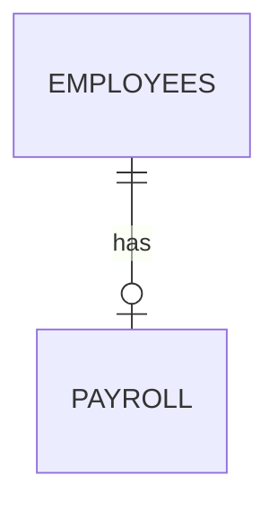

# Схема базы «Заработная плата»

Первичный ключ payroll.employee_id также является внешним ключом на employees.id. Представление payroll_summary объединяет сотрудника, ставку, расчёт удержаний и сумму к выплате.
