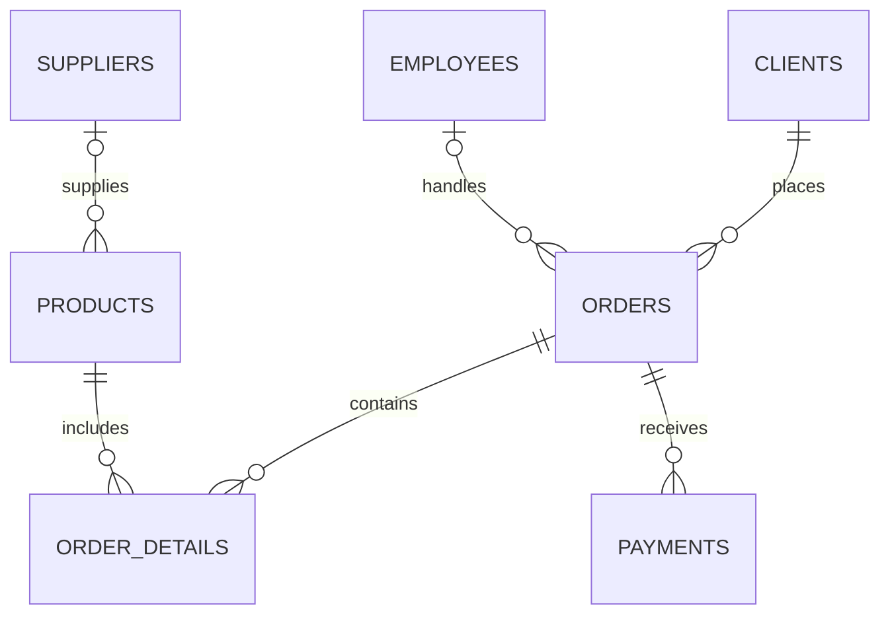

# Связи таблиц

Заказ связан с клиентом и сотрудником; товары входят в заказ через позиции заказа. Каждая позиция хранит цену на момент покупки, количество и долю скидки. Оплаты хранятся отдельно от позиций, поскольку один заказ может оплачиваться несколькими платежами.
