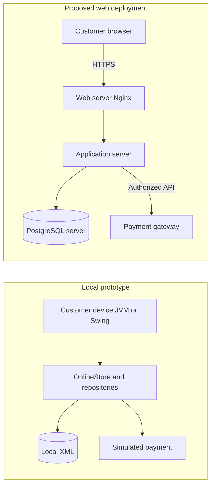

# Deployment

Proposed web deployment versus the local Java prototype.

The web deployment is a design proposal. The implemented local prototype stores orders in XML and uses a simulated payment gateway.
