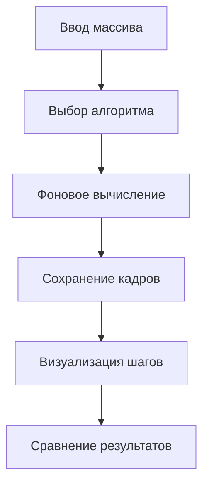

# Документация к программе Обучающий тренажёр

## Назначение

Тренажёр знакомит учащихся 10–11 классов с тремя алгоритмами сортировки. Он работает с последовательностью 2–30 целых чисел.

## Руководство пользователя

1. Открыть программу. Ввести массив через пробелы или открыть текстовый файл через меню Файл. Кнопка Случайный создаёт массив заданной длины.
2. Выбрать алгоритм в списке Bubble, Selection или Insertion.
3. Нажать Описание: в отдельном окне приведена логика и блок-последовательность алгоритма.
4. Нажать Запуск: столбцы массива меняются в ходе выполнения. Оранжевые столбцы обозначают текущую операцию. Кнопка Шаг позволяет перейти к следующему состоянию; шкала выводит номер операции.
5. Нажать Сравнить: для одного исходного набора отображаются результаты всех трёх алгоритмов, количество сравнений, записей и время.
6. Закрыть программу через меню Файл.

## Сравнение

| Алгоритм | Лучший | Худший | Стабильность |
|---|---|---|---|
| Bubble | O(n) | O(n²) | Да |
| Selection | O(n²) | O(n²) | Нет |
| Insertion | O(n) | O(n²) | Да |

Каждый обмен записывает два элемента. Времена на небольших массивах чувствительны к JIT и шуму ОС. Для сравнения используется исходная копия массива, замеры выполняются без сохранения кадров. Генератор и сортировщик — отдельные BackgroundWorker, таймер UI только отображает готовые кадры.

## Схема

## Проверка на Windows

Проверить обратный и уже упорядоченный массивы, повторяющиеся числа, отрицательные значения, недопустимый ввод, открытие файла, три окна и меню. Фактическую сборку в Visual Studio, скриншоты и замеры ещё необходимо получить. Этот текст можно перенести в Word.
